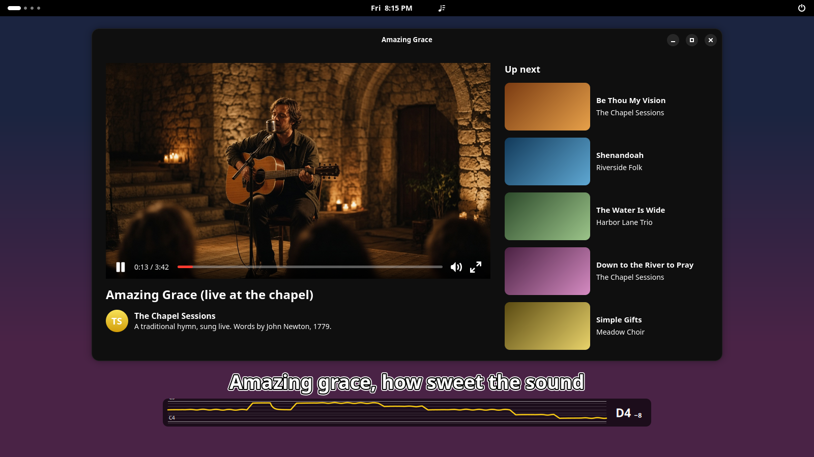
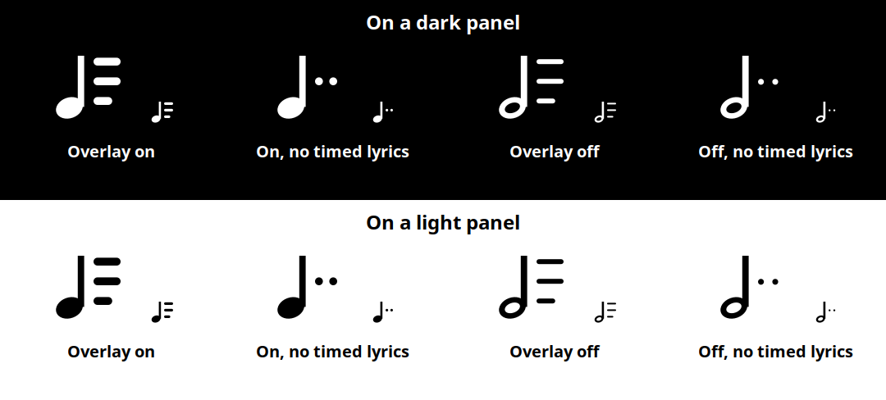
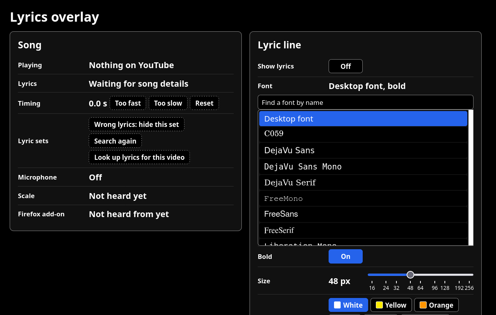

# Lyrics overlay

This adds a global overlay of the lyrics, plus a pitch meter, so you can sing
along to YouTube videos of songs.



It runs on a GNOME Shell 50 desktop with YouTube in Firefox. When a YouTube
or YouTube Music tab plays a song, the line about to be sung shows above all
your windows, timed to the video, and the pitch meter draws the pitch you
sing into the microphone. Lyrics come from [LRCLIB](https://lrclib.net),
found from the video's title and YouTube's own song details; a song without
timed lyrics there shows no line.

It has three parts:

- a Firefox add-on (`firefox/`) that tells the local service what the YouTube
  tab is playing; it sends nothing off the computer;
- a service (`service/`, a gjs program run as the systemd user unit
  `lyrics-overlay.service`) that finds the lyrics, remembers your choices and
  timing for each video, decides which line shows when, follows the pitch
  you sing, and serves the settings page;
- a GNOME Shell extension (`gnome-extension/lyrics-overlay@ernop`) that draws
  the indicator, the line and the pitch panel.

## Requirements

- GNOME Shell 50 (Ubuntu 26.04 or another distribution with it)
- Firefox 142 or later
- `sudo apt install gjs gir1.2-soup-3.0 libglib2.0-bin pipewire pipewire-bin`
- Node.js and npm, only to run the tests

## Install

```
git clone https://github.com/ernop/lyrics-overlay.git
cd lyrics-overlay
scripts/install.sh
```

`scripts/install.sh` checks the requirements, creates `settings.json` from
`settings.example.json`, installs and starts the service, and installs the
shell extension. Then:

1. Log out and back in; GNOME Shell loads extensions at login.
2. Download
   [lyrics-overlay.xpi](https://github.com/ernop/lyrics-overlay/releases/latest/download/lyrics-overlay.xpi)
   and open it in Firefox (drag it onto a Firefox window); press Add.

For more fonts, `scripts/install-fonts.sh` adds about 160 of Ubuntu's font
packages for your user alone (no root). The settings page lists them at once;
GNOME Shell draws them after the next login.

To update: `git pull && scripts/install.sh`. The service restarts at once; the
shell extension changes at the next login. From 1.3.0 Firefox updates the
add-on by itself (it checks the newest GitHub release once a day), and the
settings page shows the add-on's version, with an install button when
Firefox runs an older one. An add-on updated from 1.0 or 1.1 opens a page
asking for access to localhost, which it needs to find the settings tab;
press Allow there once. Going to the song works without it.

To remove:

```
systemctl --user disable --now lyrics-overlay.service
systemctl --user disable lyrics-overlay-extension-update.service   # present after an update
rm -f ~/.config/systemd/user/lyrics-overlay*.service
gnome-extensions uninstall lyrics-overlay@ernop
rm -rf ~/.local/state/lyrics-overlay   # remembered choices, timing and caches
```

and remove the add-on in Firefox's Add-ons and themes page.

## Using it

The indicator shows while YouTube plays sound and for two minutes after.



| Where | Action | Result |
|---|---|---|
| Indicator | press | lyric line on or off |
| Indicator | right-press | the settings page |
| Lyric | click | goes to the song's Firefox tab and raises its window |
| Lyric | right-click | the settings page |
| Lyric | Ctrl+drag | moves the box |
| Lyric | Alt+drag | resizes the box |
| Lyric | Ctrl+scroll | changes the text size |
| Pitch panel | drag an edge | resizes it |
| Pitch panel | drag a separate one | moves it; dropped against a side of the lyric, it docks there |
| Pitch panel | drag a docked one away | makes it separate |
| Pitch panel | right-press | the settings page |

Where no lyric is drawn, clicks reach the windows below.

## The settings page

Everything is set on one page in Firefox, http://localhost:8792/settings, and
each change shows on the line and the pitch panel as you make it. A right
press on the indicator, the lyric or the pitch panel selects that tab, or
opens it, and raises its window; there is only ever one.



| Section | What it holds |
|---|---|
| Song | what is playing, its lyric status, timing (Too fast / Too slow move the lyrics 0.5 s, Reset; kept for each video), the lyric sets (Wrong lyrics: hide this set, Search again, Look up lyrics for this video), the microphone, the song's scale as heard, and the Firefox add-on's version, with an install button when Firefox runs an older one |
| Lyric line | on or off; font, the desktop font or any installed family that can write English, found by typing part of its name; bold; size, 16 to 256 px; color; border, double, single or none, 0.25 to 4 times as thick; alignment; transition; reset position and size |
| Pitch panel | on or off; below, above, left or right of the lyric, or separate; the notes shown, a fixed range (set, or fitted to your last 30 s of singing) or a span that follows your voice; time across, 2 to 120 s; scrolling through silences; line thickness and color; background; note names on the lines; the scale whose lines stand out, detected from the song, fixed, or none; where the current note shows, its size and cents; analyses per second |
| Microphone | which input; echo cancelling, on by default, so the trace follows you and not the song |
| Mouse | the pointer actions above |

White with a double border (the default), then yellow with a single border,
left-aligned:


## Service settings

`settings.json` (created from `settings.example.json`; restart the service
after a change with `systemctl --user restart lyrics-overlay.service`):

| Key | Default | Meaning |
|---|---|---|
| `port` | `8792` | the service's port on 127.0.0.1; the add-on, the shell extension and the settings page use 8792 |
| `hostname` | `"lyrics.localhost"` | one more name the service answers to, such as a local proxy's |
| `lrclibBaseUrl` | `"https://lrclib.net"` | the LRCLIB server |
| `ytarchiveUrl` | `null` | a ytarchive server that receives each video played and its lyrics; `null` sends nothing |
| `stateDir` | `"~/.local/state/lyrics-overlay"` | choices, timing and caches |

## Network and privacy

- The add-on reports only to the service on this computer.
- The service asks LRCLIB for lyrics with a generic User-Agent. Every answer
  is kept for 7 days, and searches are capped at 20 a minute, 200 an hour and
  1000 a day, across restarts.
- The microphone opens only while the line and the pitch panel are on and
  YouTube is playing sound.
- While the pitch panel shows a scale detected from the song, the service
  also listens to what the computer plays (not the microphone) to find the
  key. For each video it keeps only the summed energy of each note name.
- Audio stays in memory.

## Development

```
npm install
npm test            # unit suites and the real service against a stand-in LRCLIB
npm run lint        # web-ext lint on the add-on
npm run test:shell  # a headless GNOME Shell with the extension and service
```

[docs/product.md](docs/product.md) holds the requirements and decisions,
[docs/architecture.md](docs/architecture.md) how the parts fit together, and
[docs/operations.md](docs/operations.md) install details, tests and releases.
[AGENTS.md](AGENTS.md) is the entry point for coding agents.

## License

MIT; see [LICENSE](LICENSE).
