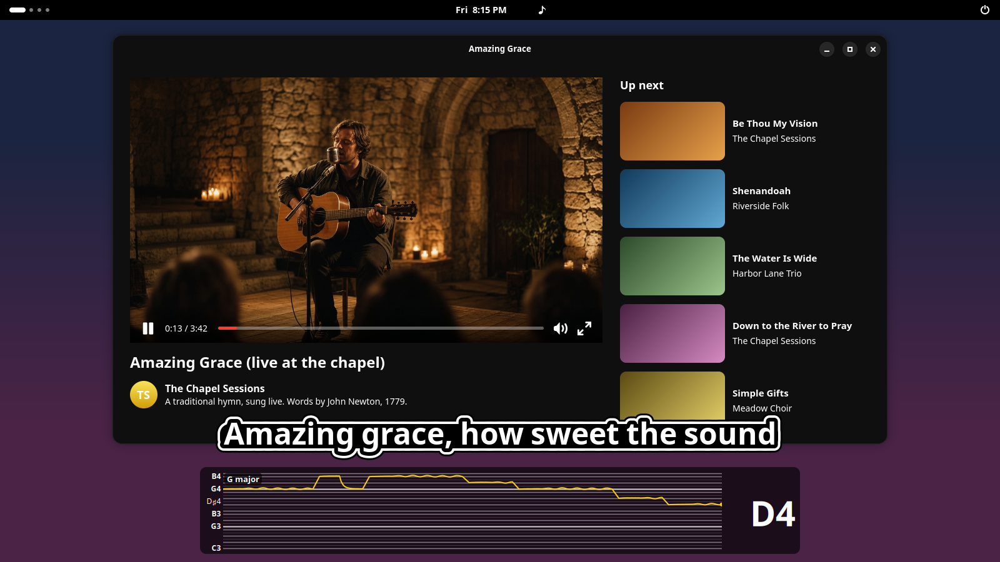
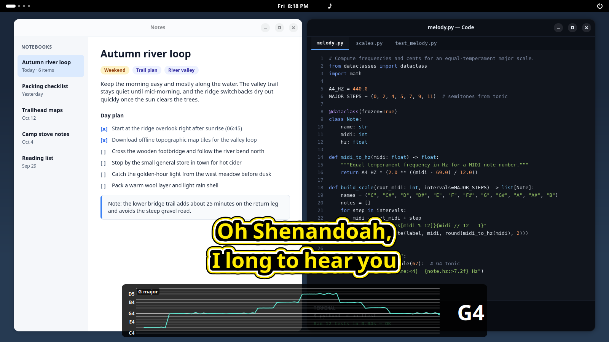
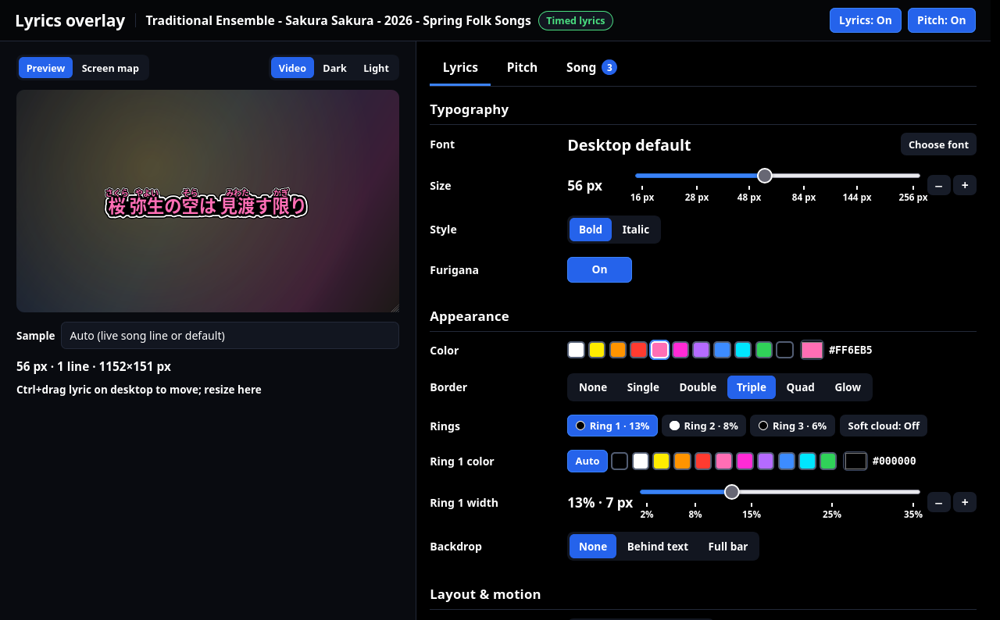
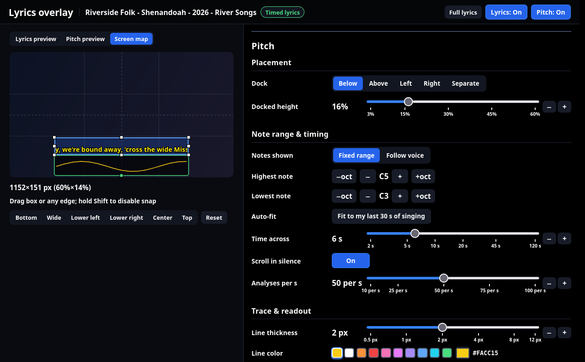
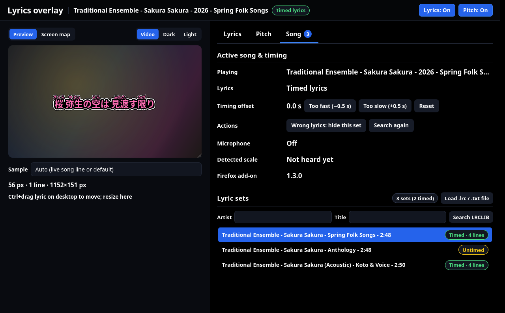

# Lyrics overlay

Timed lyrics and a live singing pitch meter that float over your Linux desktop
while a song plays in YouTube or YouTube Music in Firefox.

It is meant for singing along casually while you watch a video or while you
work on something else. When a song starts playing in any Firefox tab — even
hidden on another workspace — the current line appears above your windows,
timed to the music, and an optional pitch meter beside or below it draws the
notes you sing into your microphone against the song's scale.

Lyrics are matched automatically, and your choices and timing adjustments are
remembered per video. If a track is slightly off or missing, you can nudge the
timing in half-second steps, search by artist and title, load your own `.lrc`
or `.txt` file, or let an optional local tool time the lyrics directly from the
audio. Layered borders keep the text legible over bright and dark windows
without a solid background bar, optional offline Japanese furigana places
hiragana readings above kanji, and clicking a lyric jumps straight back to the
playing tab while empty space passes clicks through to whatever sits behind it.



## Sing from any workspace

YouTube does not need to stay on screen. While you read, write, or code in
other windows, the lyrics and pitch meter float unobtrusively over both bright
and dark apps, with a small note icon in the top bar whenever music is playing.



## Readable over bright and dark scenes

Pick a font, size, color, and 1 to 4 concentric border rings — with automatic
high-contrast colors, custom per-ring colors and widths, or a soft glow — plus
optional offline Japanese furigana above kanji.


## Live settings and layout

Right-click the lyric, pitch panel, or top-bar note to open the single settings
page (`http://localhost:8792/settings`). Every change updates the live overlay
immediately.



Arrange the lyric box and pitch panel directly on a map of your monitor, dock
the pitch panel on any side (or detach it), and adjust note range, scale
highlighting, and microphone choice:



For the current song, nudge timing, switch between lyric sets, search LRCLIB by
artist and title, load a local `.lrc` or `.txt` file, or trigger local timing:



## Everyday controls

| Action | Result |
|---|---|
| Click lyric | Jumps to the song's Firefox tab and raises its window |
| `Ctrl+drag` lyric | Moves it with center/edge snap (`Shift` bypasses snap, `Esc` cancels) |
| `Ctrl+scroll` lyric | Resizes the text |
| `Ctrl+drag` pitch panel | Moves, resizes from any edge, or docks against a side of the lyric |
| Click top-bar note | Toggles the overlay on or off |
| Right-click lyric, pitch panel, or note | Opens or raises the settings page |

---

## Install

Requires a Linux desktop (Wayland with XWayland, or X11) and Firefox 142+.

```sh
sudo apt install gjs gir1.2-soup-3.0 gir1.2-gtk-3.0 libglib2.0-bin pipewire pipewire-bin
git clone https://github.com/ernop/lyrics-overlay.git
cd lyrics-overlay
scripts/install.sh
```

Then download
[lyrics-overlay.xpi](https://github.com/ernop/lyrics-overlay/releases/latest/download/lyrics-overlay.xpi),
drag it onto a Firefox window, and click **Add**. (From 1.3.0 onward, Firefox
keeps the add-on updated automatically.) On GNOME Wayland, `scripts/install.sh`
also installs a tiny zero-UI GNOME Shell helper (`lyrics-overlay-raiser@ernop`)
so clicking a lyric raises the exact Firefox window past Wayland focus-stealing
prevention; log out and back in once after first install so GNOME Shell loads
it.

### Optional extras

- **Local automatic lyric timing & offline Japanese furigana:** run
  `scripts/install-generator.sh` (creates a local `.venv` with `faster-whisper`
  and `sudachipy`), then enable `lyricsGenerator` in `settings.json` or toggle
  **Furigana** on the settings page.
- **Extra fonts:** `scripts/install-fonts.sh` unpacks extra fonts into
  `~/.local/share/fonts/` for your user.
- **Update:** `git pull && scripts/install.sh` (overlay and service changes
  restart immediately, no logout).
- **Remove:** `systemctl --user disable --now lyrics-overlay.service lyrics-overlay-desktop.service && rm -f ~/.config/systemd/user/lyrics-overlay*.service && gnome-extensions disable lyrics-overlay-raiser@ernop && rm -rf ~/.local/share/gnome-shell/extensions/lyrics-overlay-raiser@ernop`, remove the add-on in Firefox, and optionally delete `~/.local/state/lyrics-overlay` and `.venv`.

## Privacy

- The Firefox add-on talks only to the local service on this computer.
- Lyric lookups go to [LRCLIB](https://lrclib.net) with a generic User-Agent,
  cached for 7 days and strictly rate-limited.
- Offline Japanese furigana and optional local audio timing run on this
  computer; temporary audio is deleted immediately and lyric text is never
  written to logs.
- Microphone and playback-key audio stay in memory and open only while music is
  playing with the pitch panel enabled.

## Technical details

The overlay consists of a small Firefox add-on (`firefox/`), a local background
service (`service/`), and a standalone desktop window process (`desktop/`).
Configuration lives in `settings.json` (copied from `settings.example.json`);
run `npm test` and `npm run lint` to run the test suite.

For full architecture, configuration keys, verification commands, and release
steps, see [docs/product.md](docs/product.md),
[docs/architecture.md](docs/architecture.md), and
[docs/operations.md](docs/operations.md).

## License

MIT; see [LICENSE](LICENSE).
