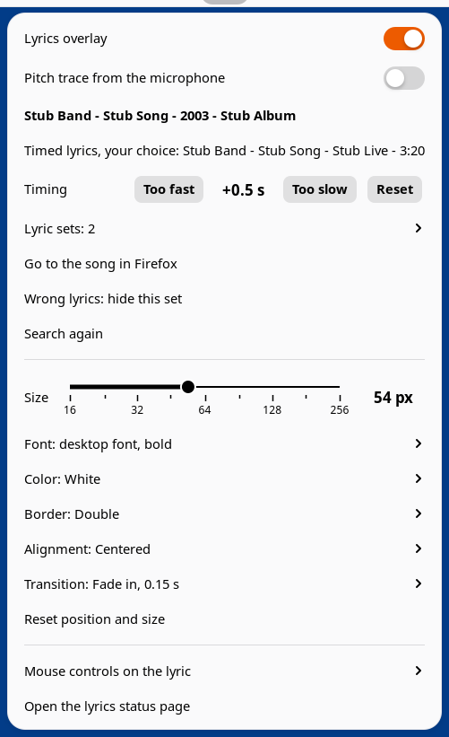
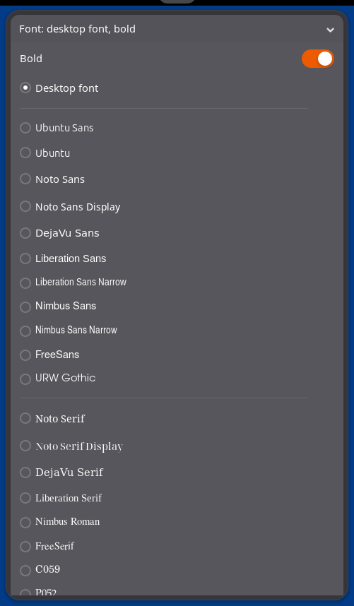

# Lyrics overlay

This adds a global overlay of the lyrics, plus a pitch meter, so you can sing
along to YouTube videos of songs.


It runs on a GNOME Shell 50 desktop with YouTube in Firefox. When a YouTube
or YouTube Music tab plays a song, the line about to be sung shows above all
your windows, timed to the video, and the pitch meter draws the pitch you
sing into the microphone. Lyrics come from [LRCLIB](https://lrclib.net),
found from the video's title and YouTube's own song details; a song without
timed lyrics there shows no line.

It has three parts:

- a Firefox add-on (`firefox/`) that tells the local service what the YouTube
  tab is playing; it sends nothing off the computer;
- a service (`service/`, a gjs program run as the systemd user unit
  `lyrics-overlay.service`) that finds the lyrics, remembers your choices and
  timing for each video, and decides which line shows when;
- a GNOME Shell extension (`gnome-extension/lyrics-overlay@ernop`) that draws
  the indicator, its menu, the line and the pitch trace.

## Requirements

- GNOME Shell 50 (Ubuntu 26.04 or another distribution with it)
- Firefox 142 or later
- `sudo apt install gjs gir1.2-soup-3.0 libglib2.0-bin pipewire pipewire-bin`
- Node.js and npm, only to run the tests

## Install

```
git clone https://github.com/ernop/lyrics-overlay.git
cd lyrics-overlay
scripts/install.sh
```

`scripts/install.sh` checks the requirements, creates `settings.json` from
`settings.example.json`, installs and starts the service, and installs the
shell extension. Then:

1. Log out and back in; GNOME Shell loads extensions at login.
2. Download
   [lyrics-overlay.xpi](https://github.com/ernop/lyrics-overlay/releases/latest/download/lyrics-overlay.xpi)
   and open it in Firefox (drag it onto a Firefox window); press Add.

To update: `git pull && scripts/install.sh`. The service restarts at once; the
shell extension changes at the next login.

To remove:

```
systemctl --user disable --now lyrics-overlay.service
systemctl --user disable lyrics-overlay-extension-update.service   # present after an update
rm -f ~/.config/systemd/user/lyrics-overlay*.service
gnome-extensions uninstall lyrics-overlay@ernop
rm -rf ~/.local/state/lyrics-overlay   # remembered choices, timing and caches
```

and remove the add-on in Firefox's Add-ons and themes page.

## Using it

The indicator shows while YouTube plays sound and for two minutes after.


| Where | Action | Result |
|---|---|---|
| Indicator | press | lyric line on or off |
| Indicator | right-press | the menu |
| Lyric | click | goes to the song's Firefox tab and raises its window |
| Lyric | right-click | the menu, at the pointer |
| Lyric | Ctrl+drag | moves the box |
| Lyric | Alt+drag | resizes the box |
| Lyric | Ctrl+scroll | changes the text size |

Where no lyric is drawn, clicks reach the windows below.

## The menu



| Item | What it does |
|---|---|
| Lyrics overlay | the lyric line, on or off |
| Pitch trace from the microphone | a trace of the pitch you sing, beside the line |
| Song and lyric status | the song as identified and the lyric set in use |
| Timing | Too fast / Too slow move the lyrics 0.5 s; Reset; kept for each video |
| Lyric sets | every set found; pick another |
| Go to the song in Firefox | selects the song's tab and raises its window |
| Wrong lyrics: hide this set | hides the set for this video and uses the next one |
| Search again | asks LRCLIB again |
| Look up lyrics for this video | for a video not recognized as a song |
| Size | 16 to 256 px |
| Font | the desktop font or an installed family; bold or not |
| Color | white, yellow, orange, red, pink, magenta, purple, blue, cyan, green, black |
| Border | double, single or none |
| Alignment | centered or left |
| Transition | instant, fade in (0.15 s), quick crossfade (0.12 s), soft crossfade (0.25 s) |
| Reset position and size | puts the box back at the bottom center |
| Mouse controls on the lyric | the pointer actions above |
| Open the lyrics status page | http://lyrics.localhost:8792/ |

White with a double border (the default), then yellow with a single border,
left-aligned:


Fonts are listed sans, serif, monospace, then script, each name in its own
face:



## Settings

`settings.json` (created from `settings.example.json`; restart the service
after a change with `systemctl --user restart lyrics-overlay.service`):

| Key | Default | Meaning |
|---|---|---|
| `port` | `8792` | the service's port on 127.0.0.1; the add-on and the shell extension use 8792 |
| `hostname` | `"lyrics.localhost"` | one more name the service answers to, such as a local proxy's |
| `lrclibBaseUrl` | `"https://lrclib.net"` | the LRCLIB server |
| `ytarchiveUrl` | `null` | a ytarchive server that receives each video played and its lyrics; `null` sends nothing |
| `stateDir` | `"~/.local/state/lyrics-overlay"` | choices, timing and caches |

## Network and privacy

- The add-on reports only to the service on this computer.
- The service asks LRCLIB for lyrics with a generic User-Agent. Every answer
  is kept for 7 days, and searches are capped at 20 a minute, 200 an hour and
  1000 a day, across restarts.
- The microphone opens only while the line and the pitch trace are on and
  YouTube is playing sound. Audio stays in memory.

## Development

```
npm install
npm test            # unit suites and the real service against a stand-in LRCLIB
npm run lint        # web-ext lint on the add-on
npm run test:shell  # a headless GNOME Shell with the extension and service
```

[docs/product.md](docs/product.md) holds the requirements and decisions,
[docs/architecture.md](docs/architecture.md) how the parts fit together, and
[docs/operations.md](docs/operations.md) install details, tests and releases.
[AGENTS.md](AGENTS.md) is the entry point for coding agents.

## License

MIT; see [LICENSE](LICENSE).
