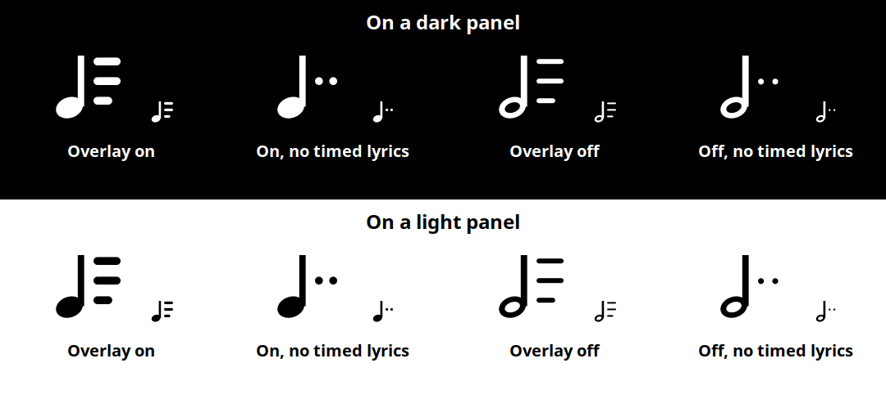

# Lyrics overlay

A global desktop overlay of timed lyrics and a live pitch meter, so you can
sing along to YouTube and YouTube Music videos from any workspace.


It runs on a GNOME Shell 50 desktop with YouTube in Firefox. When a YouTube
or YouTube Music tab plays a song, the line about to be sung appears above
normal windows, timed to the video, and the pitch meter draws the pitch you
sing into the microphone. Lyrics come from [LRCLIB](https://lrclib.net),
matched from the video's title and YouTube's song details. With optional local
automatic lyric timing enabled, songs missing synced lyrics on LRCLIB are
timed directly from their audio using local
[faster-whisper](https://github.com/SYSTRAN/faster-whisper) (aligning LRCLIB's
plain lyrics onto word timestamps when available, or transcribing sung lines
otherwise), while a quiet pill in the overlay reports progress.

It has three parts:

- a Firefox add-on (`firefox/`) that tells the local service what the YouTube
  tab is playing; it sends nothing off the computer;
- a service (`service/`, a gjs program run as the systemd user unit
  `lyrics-overlay.service`) that finds or generates timed lyrics, remembers
  your choices and timing for each video, decides which line shows when,
  follows the pitch you sing, detects the song's key, and serves the settings
  page;
- a GNOME Shell extension (`gnome-extension/lyrics-overlay@ernop`) that draws
  the indicator, the lyric line, the quiet timing status pill, and the pitch
  panel.

## Requirements

- GNOME Shell 50 (Ubuntu 26.04 or another distribution with it)
- Firefox 142 or later
- `sudo apt install gjs gir1.2-soup-3.0 libglib2.0-bin pipewire pipewire-bin`
- Optional, for local automatic lyric timing: `ffmpeg`, `yt-dlp`, and `uv` (or
  Python 3.10+ with `venv`); a CUDA GPU speeds timing to roughly 20x real-time
  with `large-v3`, or it can run on CPU (`device: "cpu"`, `computeType: "int8"`).
- Node.js and npm, only to run the tests.

## Install

```
git clone https://github.com/ernop/lyrics-overlay.git
cd lyrics-overlay
scripts/install.sh
```

`scripts/install.sh` checks the requirements, creates `settings.json` from
`settings.example.json`, installs and starts `lyrics-overlay.service`, and
installs the GNOME Shell extension. Then:

1. Log out and back in; GNOME Shell loads extension code at login.
2. Download
   [lyrics-overlay.xpi](https://github.com/ernop/lyrics-overlay/releases/latest/download/lyrics-overlay.xpi)
   and open it in Firefox (drag it onto a Firefox window); press Add.

### Optional: automatic lyric timing

To generate timed lyrics locally for songs without synced LRCLIB lyrics:

```
scripts/install-generator.sh
```

This creates a local `.venv` with `faster-whisper` and CUDA runtime libraries
(nothing is installed globally). Then add a `lyricsGenerator` block to
`settings.json` (see [Service settings](#service-settings)) and restart the
service:

```
systemctl --user restart lyrics-overlay.service
```

### Optional: more fonts

`scripts/install-fonts.sh` adds about 160 of Ubuntu's font packages into
`~/.local/share/fonts/` for your user alone (no root). The settings page lists
them at once; GNOME Shell draws them after the next login.

### Update

```
git pull && scripts/install.sh
```

The service restarts at once; the shell extension update is staged and applied
automatically at the next login before GNOME Shell starts. From 1.3.0 Firefox
updates the add-on by itself (checking the newest GitHub release once a day),
and the settings page's Song tab shows the running version with an install
button whenever Firefox runs an older one. Versions 1.0.0 to 1.2.0 have no
update address, so install the newest
[lyrics-overlay.xpi](https://github.com/ernop/lyrics-overlay/releases/latest/download/lyrics-overlay.xpi)
once by hand as in step 2 above. An add-on updated from 1.0 or 1.1 opens a page
asking for access to `localhost`, which it needs to find the open settings tab;
press Allow there once (clicking lyrics to raise the song works without it).

### Remove

```
systemctl --user disable --now lyrics-overlay.service
systemctl --user disable lyrics-overlay-extension-update.service   # present after an update
rm -f ~/.config/systemd/user/lyrics-overlay*.service
gnome-extensions uninstall lyrics-overlay@ernop
rm -rf ~/.local/state/lyrics-overlay   # remembered choices, timing and caches
rm -rf .venv                           # if automatic lyric timing was installed
```

and remove the add-on in Firefox's Add-ons and themes page.

## Using it

The indicator shows while YouTube plays sound and for two minutes after.



| Where | Action | Result |
|---|---|---|
| Indicator | press | lyric line on or off |
| Indicator | right-press | opens or raises the settings page |
| Lyric | hover | reveals the box frame and 8 edge/corner resize handles |
| Lyric | drag edge or corner | resizes from that edge, anchoring the opposite edge |
| Lyric | drag interior | moves the box with magnetic center/edge snap (hold `Shift` to bypass snap; `Esc` cancels) |
| Lyric or timing pill | quick click | selects the song's Firefox tab and raises its window |
| Lyric or timing pill | right-click | opens or raises the settings page |
| Lyric | `Ctrl+scroll` | changes the text size |
| Pitch panel | drag an edge | resizes it |
| Pitch panel | drag a separate one | moves it; dropped against a side of the lyric, it docks there |
| Pitch panel | drag a docked one away | makes it separate |
| Pitch panel | right-press | opens or raises the settings page |

Where no lyric or timing status pill is drawn, clicks reach the windows below.

The keyboard's media keys (play/pause, next, previous) reach YouTube through
Firefox itself, which exposes each playing tab to the desktop as a media
player; this uses Firefox's `media.hardwaremediakeys.enabled` (on by default).
The keys go to the tab that played media last.

## The settings page

Everything is set on one page in Firefox, http://localhost:8792/settings, and
each change applies live on the lyric line and the pitch panel. A right press
on the indicator, the lyric, the timing status pill, or the pitch panel selects
the open settings tab (or opens one) and raises its window; there is only ever
one.


| Area | What it holds |
|---|---|
| Live stage (left, sticky) | flips between **Preview** (live lyric preview over Video/Dark/Light scenes on Lyrics/Song, or live pitch trace preview on Pitch, with editable sample text) and **Screen map** (exact monitor aspect ratio, 8-handle lyric resize and drag with center snap, pitch panel docking/resizing, multi-monitor picker, placement presets) |
| Lyrics | eight focused controls beside the preview: searchable font picker, constant size (`16-256 px`; long lines wrap evenly without shrinking), `Bold`/`Italic`, 11 colors or custom hex, proportional borders (`Double` fused x-height body + crisp trim + dark backing cloud, `Glow` fused body + feathered halo + soft dark cloud, `Single`, `None`), optional `Behind text` or `Full bar` backdrop, alignment, and transition |
| Pitch | docking/size, fixed or voice-following range (or fit to last 30 s), window duration, scroll in silence, trace thickness/color/background, note names, scale highlighting (detected from song, fixed, or none), current-note readout, analysis rate, PipeWire microphone picker, and echo cancelling |
| Song | active song and live lyric status (including live timing stages when generating), timing nudges (`Too fast` / `Too slow` in `0.5 s` steps, `Reset`), single-line lyric sets with `Timed` / `Untimed` / `Aligned` / `Transcribed` pills (`Wrong lyrics`, `Search again`, `Look up`, and `Generate timed lyrics` / `Retry timing` / `Regenerate timed lyrics` when enabled), microphone and detected scale readout, and Firefox add-on version with install button when outdated |

White with a double border (the default), then yellow with a single border,
left-aligned:


## Service settings

`settings.json` (created from `settings.example.json`; restart the service
after a change with `systemctl --user restart lyrics-overlay.service`):

| Key | Default | Meaning |
|---|---|---|
| `port` | `8792` | the service's port on `127.0.0.1`; the add-on, shell extension, and settings page use `8792` |
| `hostname` | `"lyrics.localhost"` | one more `Host` name the service answers to, such as a local proxy's |
| `lrclibBaseUrl` | `"https://lrclib.net"` | the LRCLIB server |
| `ytarchiveUrl` | `null` | a ytarchive server that receives each played video and its lyrics (including generated timed LRC); also checked first for local audio when generating lyrics; `null` turns it off |
| `stateDir` | `"~/.local/state/lyrics-overlay"` | remembered choices, timing, generated lyrics, and caches |
| `lyricsGenerator` | `null` | optional local automatic lyric timing config (example below); `null` turns it off |

Example `lyricsGenerator` block in `settings.json`:

```json
"lyricsGenerator": {
  "command": [".venv/bin/python", "service/generate-lyrics.py"],
  "model": "large-v3",
  "device": "cuda",
  "computeType": "float16",
  "maxDurationSeconds": 900,
  "gpuGate": null
}
```

- `command`: executable and script path (relative paths resolve from the repo root).
- `model`, `device` (`"auto"`, `"cuda"`, `"cpu"`), `computeType` (`"auto"`, `"float16"`, `"int8"`): passed to `faster-whisper`.
- `maxDurationSeconds`: skips automatic generation for longer videos (default `900`, 15 minutes).
- `gpuGate`: optional wrapper command for a shared local GPU coordinator (`{command, name, what, gb, lane, minutes, waitMinutes}`), or `null` to run directly.

## Checking that it works

With a song playing:

| Check | Expect |
|---|---|
| `systemctl --user status lyrics-overlay.service` | `active (running)` |
| `curl -s http://127.0.0.1:8792/api/state` | `state.lyrics` is `timed` (or `generating` while automatic timing runs); `addon.status` is `current`, not `older`, `unnamed`, or `unheard`; `state.generation.available` is `true` when `lyricsGenerator` is configured |
| `gnome-extensions info lyrics-overlay@ernop` | `State: ACTIVE` |
| `python3 scripts/check-live-desktop.py` | the indicator and the lyric line are drawn, and where |
| `journalctl --user -u lyrics-overlay.service` | one `lookup <video>` line per video (`timed`, `plain`, or `none`), plus `generate <video>` when automatic timing runs |

If no line shows:

- `lyrics` is `generating`: automatic lyric timing is fetching audio, waiting
  for the GPU, or transcribing; a quiet pill appears in the overlay until the
  timed lines arrive.
- `lyrics` is `none` or `plain`: LRCLIB has no timed lyrics for the song (and
  automatic timing is either disabled, skipped for an instrumental/long video,
  or busy). The settings page's Song tab can search again, pick another lyric
  set, or run `Generate timed lyrics` / `Retry timing`.
- `addon.status` is `unheard`: no add-on has reported since the service
  started. Check that the add-on is installed and enabled in Firefox and that
  the YouTube tab plays sound.
- `addon.status` is `older` or `unnamed`: Firefox runs an old add-on; use the
  settings page's install button, or install the `.xpi` as in Install.
- The extension is not `ACTIVE` (or clicks stop working after another extension
  toggles): log out and back in once after `scripts/install.sh`; GNOME Shell
  loads extension code only at login.

## Network and privacy

- The Firefox add-on reports only to the service on this computer.
- The service asks LRCLIB for lyrics with a generic User-Agent. Every answer is
  kept for 7 days, and searches are capped at 20 a minute, 200 an hour, and
  1000 a day across restarts.
- When `lyricsGenerator` is configured and LRCLIB has no synced lyrics, the
  generator checks local `ytarchiveUrl` for an already-archived soundtrack
  first and otherwise downloads the song's audio with anonymous `yt-dlp` (no
  cookies, `--no-playlist --ignore-config`). Whisper runs locally, the
  temporary audio file is deleted immediately after transcription, and lyric
  text is never written to logs.
- The microphone opens only while the line and the pitch panel are on and
  YouTube is playing sound.
- While the pitch panel shows a scale detected from the song, the service also
  listens to what the computer plays (not the microphone) to find the key,
  keeping only summed pitch-class energy per video.
- Microphone and speaker-monitor audio stays in memory.

## Development

```
npm install
npm test            # unit suites and the real gjs service against stand-ins
npm run lint        # web-ext lint on the Firefox add-on
npm run test:shell  # headless GNOME Shell with the real extension and service
```

[docs/product.md](docs/product.md) holds the requirements and decisions,
[docs/architecture.md](docs/architecture.md) how the parts fit together, and
[docs/operations.md](docs/operations.md) install details, tests, and releases.
[AGENTS.md](AGENTS.md) is the entry point for coding agents.

## License

MIT; see [LICENSE](LICENSE).
